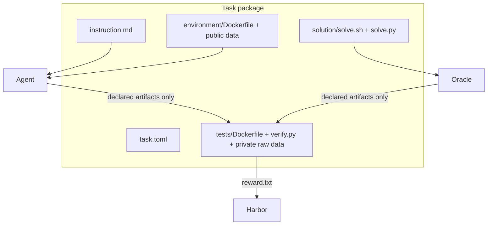
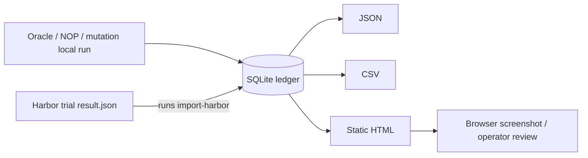

# Architecture

## Boundaries

A task package is usable without installing the suite Python package. Its agent image copies only `environment/data/` into `/app/data`; Harbor mounts the Oracle from `solution/`; the verifier image bakes `tests/`, including a pristine private input copy. `task.toml` declares individual `/app/output` artifacts and sets `[verifier].environment_mode = "separate"`.

The agent and verifier phases use different containers. The verifier image does not receive the agent workspace or its shell history; Harbor transfers only the paths declared in `artifacts`.

## Suite-management layer

`src/manufacturing_bench` intentionally uses the Python standard library for its runtime path to keep bootstrap dependencies small:

- `tasks.py` parses current task metadata using `tomllib`.
- `validator.py` statically checks artifact scope, verifier separation, instruction suffix, Docker layout and provenance manifests.
- `local_runner.py` mirrors the artifact handoff in a temporary run directory and invokes only checked-in Oracle/verifier programs.
- `database.py` stores run metadata in `.mfgbench/runs.sqlite3`; `runs/<id>/` retains stdout/stderr, verifier result and workspace when requested.
- `reporting.py` renders static JSON/CSV/HTML reports from observed records and separates baseline from external agent trials.
- `providers.py` validates opt-in provider configuration and only reaches the network behind an explicit `--network` flag.
- `harbor.py` wraps an installed Harbor CLI with argument lists rather than shell strings, checks Docker before execution, and imports persisted trial results.
- `generation.py` calls the seeded fixture generator and writes either a scratch profile or reviewed canonical fixtures.

## Local runner versus Harbor

The local runner is for rapid offline implementation validation. It copies public inputs read-only, invokes the Oracle/NOP/mutator, passes only the synthetic `/app/output` path to the verifier, and persists evidence. It cannot claim container isolation. A Harbor run is the authority for image builds, mounts, resource limits and artifact transfer.

## Reproducibility

`fixture-manifest.json` records an immutable seed, profile and generator version. The generator uses explicit seeds for its deterministic shuffles. Output rows are sorted explicitly and money uses `Decimal`, preventing host locale or binary-float variation. The private verifier recomputes output from private raw data rather than reading an expected-output blob.

## Reporting data flow

Token, cache-token, cost and pass@k fields remain empty unless an actual agent run supplied them.
